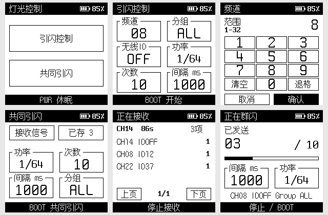

# Godox-S3-Trigger

用一块触摸墨水屏 ESP32-S3 控制神牛闪光灯，支持单个 CH / ID 的连续引闪，以及扫描现场引闪信号后的多组合共同引闪。射频收发使用 ESP32-S3 内置硬件。

当前版本 **v0.6.5**，固定 **ESP-IDF v5.5.5**，适配 Waveshare ESP32-S3-ePaper-1.54 的 200 × 200 触摸屏设备。

**本项目仅用于学习、协议研究与实验。使用者须遵守所在地无线电管理法规，确认频段、发射功率、杂散和设备使用条件，取得所需许可后开展实验。**



图片由当前固件的 C 渲染函数和内嵌字体直接生成，各页面为原生 200 × 200 像素。参数、电量和扫描组合使用示例状态。复现方法见 [UI 图片说明](docs/images/README.md)。

## 功能

| 功能 | 用途 |
| --- | --- |
| [引闪控制](docs/user-guide.md#single) | 设置 CH、Group、ID、功率、次数、间隔，按 BOOT 执行有限次数群闪 |
| [共同引闪](docs/user-guide.md#joint) | 解析现场引闪器的 CH / ID，按统一参数依次触发多个已存组合 |
| [手动添加](docs/user-guide.md#manual) | 自定义多个 CH / ID，支持 OFF、去重及持久保存 |
| [信号扫描](docs/user-guide.md#scan) | 自动轮转覆盖 CH1–32，识别 ID OFF / 1–99，最多保存 32 个组合 |
| [触摸编辑](docs/user-guide.md#parameters) | 数字键盘与选项按钮，参数和组合保存到 NVS |
| [波形缓存](docs/user-guide.md#preparation) | 参数变化后预先计算波形，显示当前准备操作与进度 |
| [屏幕状态](docs/user-guide.md#display) | 局部刷新、执行计数、停止操作、电压估算电池百分比 |
| [电源管理](docs/user-guide.md#power) | 功能页按 PWR 返回主菜单，主菜单再次按 PWR 清白屏休眠 |
| [串口诊断](docs/user-guide.md#console) | 配置参数、查看状态、固定频道接收、导出 IQ 日志 |

共同引闪使用单路射频依次发送各组合，组合间存在时间差。TEST 会触发相同 CH / ID 的灯，Group 选择功率配置对象，ALL 会给 A–E 分别设置功率。

## 硬件与验证范围

- 已使用 Waveshare ESP32-S3-ePaper-1.54，200 × 200 墨水屏、FT6336 触摸、BOOT / PWR 按键。
- 已核验 ESP32-S3-PICO-1，8MB Flash、8MB Octal PSRAM。默认 Flash DIO / 40MHz、PSRAM 40MHz、CPU 240MHz。
- 用户已确认能触发 **Godox V850II**。其他 Godox X 灯具和引闪器需要分别实测。
- 私有 PHY 集成强制使用 **ESP-IDF v5.5.5**。

32 个 CH 和两套频率表已通过离线回放。v0.6.3 真实空中自动扫描验证了 **CH14 / ID OFF**，一次 60 秒测试约 7 秒发现候选、10.6 秒完成确认，6595 次采样、0 次采样错误。其余频道、距离和干扰环境的实际延迟仍需验证。该空中接收记录来自 v0.6.3；新增手动组合与 PWR 导航通过主机测试，尚待实机验证。

## 构建与刷入

安装并激活 [ESP-IDF v5.5.5](https://github.com/espressif/esp-idf/tree/v5.5.5) 开发环境，在项目目录执行。

```sh
idf.py set-target esp32s3
idf.py build
python tools/check_elf.py build/Godox-S3-Trigger.elf --waves components/godox_waveform/waves
idf.py -p YOUR_PORT flash monitor
```

将 `YOUR_PORT` 替换成已核实的设备端口，例如 Windows 的 `COM5` 或 Linux 的 `/dev/ttyACM0`。Windows 的 ESP-IDF PowerShell 也支持 `./tools/build.ps1`，会构建并检查 RF 内存保留区域。

工程包含构建必需的驱动、字形和波形资源。首次刷入应使用完整的 `flash` 命令写入分区表与应用。分区要求 8MB Flash，见 [partitions.csv](partitions.csv)。

应用产物为 `build/Godox-S3-Trigger.bin`。`components/godox_waveform/waves/` 下的 `.bin` 是 I/Q 数据资源。

## 上手使用

每项功能的操作步骤及对应固件界面见 **[功能操作图解](docs/user-guide.md)**，包括全部参数编辑、接收、组合管理、共同引闪、准备进度、停止重播、电量、休眠与串口操作。

### 引闪控制

1. 在灯具上设置 CH、Group、ID。旧灯具没有 ID 选项时使用 OFF。
2. 主菜单进入「引闪控制」，触摸卡片修改参数，使控制器 CH / ID 与灯具匹配。
3. 初次可用 CH08、Group A、ID OFF、1/128 功率、3 次、1000ms 间隔进行观察。
4. 等待参数准备完成后按 **BOOT** 开始。运行中再次按 BOOT 或触摸底部停止。

| 参数 | 范围 |
| --- | --- |
| CH | 1–32 |
| Group | ALL、A–E |
| ID | OFF、1–99 |
| 功率 | 1/128 至 1/1，整档 |
| 次数 | 1–999 |
| 间隔 | 1–60000ms |

间隔是软件请求的发送节拍。灯具回电、射频准备和多组合发送都会影响实际闪光时间，过短时可能显示「延迟」。设备没有灯端确认，屏幕计数表示已经下发的次数。

### 共同引闪

1. 已知 CH / ID 时，进入「共同引闪 → 已存 → 手动添加」，编辑并添加组合；可连续添加多个目标。
2. 需要发现未知组合时，点击「接收信号」，按以下流程扫描。
2. 依次让现场真实引闪器发送 TEST。接收持续到手动停止，最长 2 分钟。
3. 确认的 CH / ID 组合会进入列表并保存。「已存」入口支持查看、翻页和清空。
4. 返回共同引闪页面，设置统一功率、次数、间隔和功率配置组，按 **BOOT** 执行。

扫描需要捕获真实发出的信号，双采样率确认会等待重复信号。四缓冲 PSRAM 队列让采样和解析并行，快照及换频仍有接收空档。

电池百分比根据电压估算。功能页按 PWR 停止任务并返回主菜单，在主菜单再次按 PWR 进入白屏休眠，随后按 PWR 唤醒。

## 串口与日志

```text
status
plan
set ch 8
set group ALL
set id OFF
set power 1/128
set count 3
set interval 1000
prepare
stage
stop
```

`stage` 执行引闪控制配置，`stop` 停止任务。`scan` 自动扫描，`scan 14` 固定接收 CH14，`rx_dump` 导出保留的 IQ。旧诊断 `fire [gap_ms]` 固定 CH08 / ID OFF，发送两份 TEST；`dryrun [gap_ms]` 输出离线计划。

关闭其他串口监视器后，可将扫描过程和完整 IQ 直接保存到文件。

```powershell
./tools/capture_rx_log.ps1 -Port COM5 -Seconds 60
```

跨平台可用 `python tools/capture_rx_log.py --port YOUR_PORT --seconds 60`，需要额外安装 `pyserial`。详见 [日志导出](docs/capture_rx_log.md)。

## 结构与开发

| 目录 | 内容 |
| --- | --- |
| `main/` | 启动与串口控制台 |
| `components/` | 协议、波形、RF 收发、任务控制、触摸和屏幕渲染 |
| `assets/` | 秋叶字体、Spleen 点阵字体及许可证 |
| `third_party/` | 固定版本驱动、来源与许可 |
| `tools/` | 构建检查、波形生成、实际 UI 配图生成和日志导出 |
| `tests/` | 主机回归及真实 IQ 夹具 |
| `docs/` | 当前说明和历史验证记录 |

当前版本通过 116 项主机测试与 ESP-IDF v5.5.5 构建。可选上游研究源码缺失时，3 项对比测试会明确跳过。开发与图片复现方法见 [开发说明](docs/development.md)，验证范围见 [当前记录](docs/validation-current.json)。

## 许可与致谢

项目代码采用 **GPL-3.0-or-later**，见 [LICENSE](LICENSE)。秋叶字体采用 SIL OFL 1.1，Spleen 采用 BSD-2-Clause，Waveshare EPD 数据表保留原 MIT 许可。

感谢 whstudio123/esp32-iq-tx、ESPARGOS/esp-sdr 以及 Godox 协议研究者。固定提交、修改范围和完整归属见 [第三方说明](third_party/README.md)。

私有射频接口的发射功率、杂散和地区无线法规符合性需要在实际硬件上评估。Godox 与相关产品名称归各自权利人所有。
