# 功能操作图解

适用于 v0.6.5。以下配图均由当前固件的 C 渲染函数和内嵌字体生成，页面为原生 200 × 200 像素。电量、参数、计数与扫描组合使用示例数据。墨水屏触摸后需要等待刷新，再进行下一步操作。

- 主菜单与返回。[页面导航](#navigation)
- 单个 CH / ID 群闪。[引闪控制](#single)
- 六项参数与数字键盘。[参数编辑](#parameters)
- 波形缓存与准备进度。[参数准备](#preparation)
- 手动添加 CH / ID。[手动组合](#manual)
- 扫描未知引闪器。[接收信号](#scan)
- 查看、翻页与清空组合。[组合管理](#targets)
- 多个 CH / ID 群闪。[共同引闪](#joint)
- 计数、停止、完成与重播。[执行状态](#execution)
- 电池与局部刷新。[屏幕状态](#display)
- PWR 休眠与唤醒。[电源操作](#power)
- 串口配置与 IQ 导出。[串口操作](#console)

<a id="navigation"></a>

## 页面导航

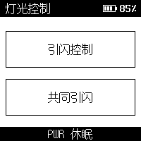

1. 开机后进入「灯光控制」主菜单。
2. 点击上方「引闪控制」，设置一个 CH / ID 的引闪任务。
3. 点击下方「共同引闪」，接收现场信号并控制多个组合。
4. 在功能页面按 PWR 返回主菜单，运行或接收中的任务会先停止。
5. 两个功能的待机参数页也支持点击左上角标题区域返回主菜单。

BOOT 在功能参数页用于开始任务，在运行页用于停止任务。PWR 在功能页用于返回主菜单，在主菜单用于休眠，休眠后用于唤醒。

<a id="single"></a>

## 引闪控制

**设置参数**

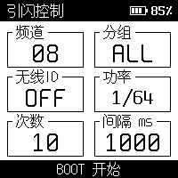

**执行中**

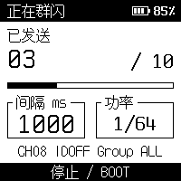

1. 先在灯具上设置频道、组和 ID。例如 CH08、Group A、ID OFF。
2. 进入「引闪控制」，将 CH、ID 设置为与灯具匹配的值，Group 选择要配置功率的组。
3. 初次可选择功率 1/128、次数 3、间隔 1000ms，便于观察每次闪光。
4. 等待准备过程结束、底部出现「BOOT 开始」后，按 BOOT 执行。
5. 运行页显示已发送数、总次数、进度、间隔和功率，下方显示本次 CH / ID / Group。

若底部显示「BOOT 准备」，先按 BOOT 进行准备，待参数页刷新完成后再次按 BOOT 开始。
TEST 会触发相同 CH / ID 的灯具，Group 指定功率配置对象。灯具上的 CH / ID 需要手动匹配。

<a id="parameters"></a>

## 参数编辑

点击参数卡片进入编辑页。数字字段首次输入会替换旧值，「退格」删除末位，「清空」清除输入。「确认」保存，「取消」放弃本次修改。范围不合法时，确认按钮显示为不可用。

### CH

点击「频道」，输入 1–32 后确认。用于匹配灯具频道。

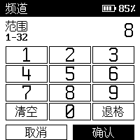

### Group

点击「分组」，选择 ALL 或 A–E 后确认。ALL 会为 A–E 分别配置功率。

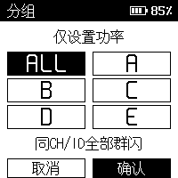

### ID

点击「无线 ID」，输入 1–99；点击左下方「OFF」可关闭 ID，再按确认。没有 ID 设置的旧灯具使用 OFF。

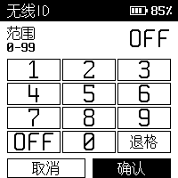

### 功率

点击「功率」，选择 1/128 至 1/1 的整档功率后确认。

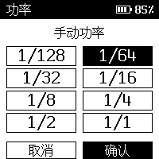

### 次数

点击「次数」，输入 1–999 后确认。共同引闪时该数值表示发送轮次。


### 间隔

点击「间隔 ms」，输入 1–60000 后确认。例如 1000 表示请求每秒开始一轮。

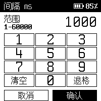

参数会保存到设备。共同引闪页可以编辑功率、次数、间隔和 Group，目标 CH / ID 来自手动添加或接收确认的组合列表。
间隔是软件请求值，实际速度还受灯具回电、射频准备和组合数量影响。

<a id="preparation"></a>

## 参数准备与波形缓存

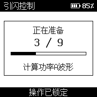

1. 在引闪控制页修改 CH、ID、Group 或功率并确认后，设备检查或重建波形缓存。
2. 弹窗显示进度及当前操作，例如检查缓存、擦除旧缓存、计算功率波形、保存或校验波形。
3. 等待弹窗关闭、参数页刷新完成，再按 BOOT 开始。

准备过程中触摸和 BOOT 操作被锁定。仅修改次数、间隔时可复用已有射频波形。
共同引闪开始前也会显示缓存或配置目标功率的准备进度。

<a id="manual"></a>

## 手动添加 CH / ID

已知现场灯具的 CH / ID 时，可以直接建立组合。

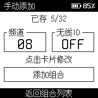

1. 进入「共同引闪」，点击「已存 N」。
2. 在组合列表中点击「手动添加」。
3. 点击「频道」卡片，输入 1–32 后确认。
4. 点击「无线 ID」卡片，输入 1–99，或点 OFF 后确认。
5. 点击「添加组合」，看到「已保存，可继续添加」后可继续修改并添加下一组。
6. 点击底部「返回组合列表」核对目标，再返回共同引闪页按 BOOT 执行。

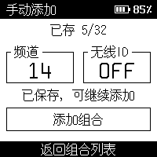

手动组合与扫描组合共用最多32项的列表。相同 CH / ID 会提示「组合已存在」，满32项提示「组合已满」。保存失败时会提示重试，失败项不会加入列表。

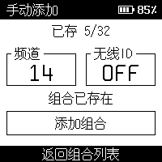

手动添加项的识别次数从0开始，实际接收确认后才增加。参数编辑页的「取消」放弃草稿，添加成功的组合会在重启后恢复。

<a id="scan"></a>

## 接收未知引闪器信号

**等待信号**

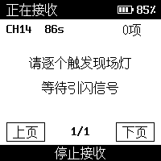

**已发现组合**

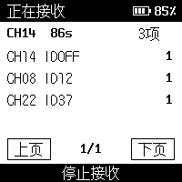

1. 从主菜单进入「共同引闪」，点击左上方「接收信号」。
2. 让现场真实引闪器反复发送 TEST，逐台操作便于辨认来源。
3. 顶部显示当前扫描频道和剩余秒数。经过确认的 CH / ID 会立即进入列表并保存。
4. 点击底部「停止接收」或按 BOOT 结束本轮，最长接收时间为 120 秒。
5. 接收结束后，点击底部「返回共同引闪」继续设置任务。

设备自动轮转覆盖 CH1–32，识别 ID OFF / 1–99。双采样率确认需要重复信号，短促单次发送可能需要重试。
v0.6.3 一轮 CH14 / ID OFF 实测约 10.6 秒完成确认，实际时间随发送节奏和环境变化。

<a id="targets"></a>

## 已存组合的查看、翻页与清空

**第一页**

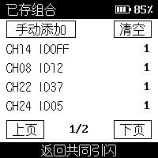

**下一页**

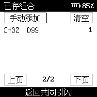

**清空后**

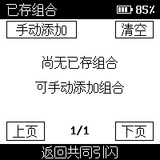

1. 在共同引闪页点击右上方「已存 N」，打开缓存列表。
2. 每页最多显示 4 个组合，点击「上页」「下页」翻页。每行右侧数字是该组合的累计识别次数。
3. 相同 CH / ID 再次被确认时，识别次数增加。列表最多保存 32 个不同组合。
4. 接收停止后，点击右上方「清空」会立即删除全部已存组合，请在需要重新布置现场时使用。
5. 点击底部「返回共同引闪」退出列表。设备会保存组合，重启后可继续使用。

<a id="joint"></a>

## 共同引闪

**配置共同引闪**

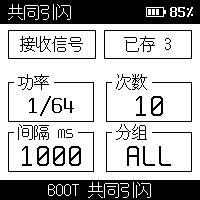

**发送轮次**

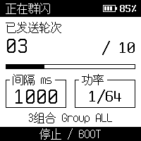

1. 先手动添加组合或完成信号接收，在「已存」列表核对目标。
2. 返回共同引闪页，点击卡片设置统一功率、次数、间隔和 Group。
3. 按 BOOT 开始，等待准备弹窗结束后进入运行页。
4. 每一轮会向所有已存 CH / ID 组合依次发送引闪命令。运行页显示「已发送轮次」和组合数量。
5. 按 BOOT 或点击底部「停止」结束后续轮次。

例如已存 3 个组合、次数设为 10，则请求执行 10 轮，每轮遍历 3 个组合。
单路射频逐个发送，组合之间存在时间差。组合数量和准备开销会影响最短可执行间隔。

<a id="execution"></a>

## 停止、完成与再次执行

**运行中**


**已停止**

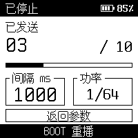

**执行完成**

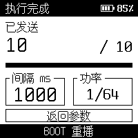

1. 运行中按 BOOT，或触摸底部「停止 / BOOT」，取消后续发送。
2. 停止后显示「已停止」及已经下发的计数，正常达到设定次数后显示「执行完成」。
3. 点击「返回参数」可修改下一次任务，按 BOOT 可从头重播。
4. 若界面提示重新准备，等待准备和参数页刷新完成后再开始。

运行时参数编辑锁定。出现「延迟」表示当前节拍无法按请求的间隔执行。
设备没有闪光灯端确认，计数记录已下发命令或轮次，实际闪光还需观察灯具。

### 准备失败时

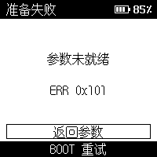

记录页面中的错误码，点击「返回参数」核对配置，再按 BOOT 重试。串口 `status` 可查看最后的返回状态。
图中 `ERR 0x101` 为示例错误状态，排查时以设备实际显示为准。

<a id="display"></a>

## 电池显示与局部刷新


- 页面右上角显示电池图标及电压估算百分比，示例为 85%。
- 编辑参数、计数变化和电量更新时，设备会刷新对应区域。点击后等待新页面显示完成再继续。
- 电量估算会受负载和电池状态影响，当前显示用于参考剩余电量。

<a id="power"></a>

## PWR 休眠与唤醒

**唤醒后的主菜单**


**休眠时全白屏**


1. 功能页按下并松开 PWR，停止当前任务并返回主菜单；编辑中的草稿会放弃。
2. 在主菜单再次按下并松开 PWR，清白屏后进入深度睡眠。
3. 休眠时再次按 PWR 唤醒，进入主菜单，保存的参数与组合会恢复。
4. 长按只触发一次，松开后重新按下才执行下一步。

右图由固件休眠状态直接渲染，因此整张图为白色。休眠采用电源保持与深度睡眠，电池仍与设备连接。

<a id="console"></a>

## 串口配置与接收日志

**在设备查看配置**


**在设备观察接收**


连接设备 USB 串口，在 ESP-IDF 环境中运行 `idf.py -p YOUR_PORT monitor`，将端口替换为实际设备。
以下命令可设置一组引闪控制参数，并执行任务。

```text
status
set ch 8
set group A
set id OFF
set power 1/128
set count 3
set interval 1000
prepare
stage
stop
```

逐条等待命令完成。`prepare` 后先等待设备准备完成，再发送 `stage`。命令参数可在触摸端的引闪控制页核对。

- `status`。查看配置、最后返回码、采样数和已存组合。
- `plan`。查看当前射频发送计划。
- `scan`。开始自动扫频接收。
- `scan 14`。固定接收 CH14，用于已知频道排查。
- `stop`。请求停止当前任务。
- `rx_dump`。停止扫描并等待空闲，导出保留的 IQ。
- `dryrun 1000`。输出旧 CH08 / ID OFF 两次 TEST 的离线计划。
- `fire 1000`。执行旧 CH08 / ID OFF 两次 TEST 诊断，间隔参数为 1000ms。

导出完整日志前关闭其他串口监视器，在项目目录运行以下工具。扫描期间持续操作真实引闪器发送 TEST。

```powershell
./tools/capture_rx_log.ps1 -Port COM5 -Seconds 60
```

工具会扫描、停止并导出 IQ，在结束时给出日志文件路径。固定频道测试可附加 `-Channel 14`。
跨平台工具和离线解析方法见 [日志导出说明](capture_rx_log.md)。
